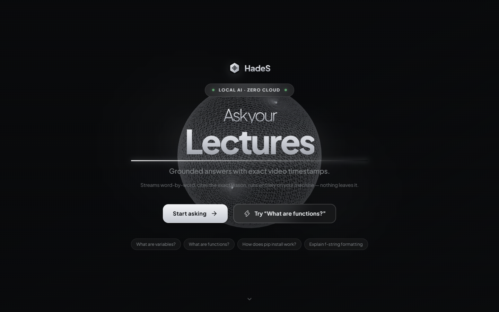
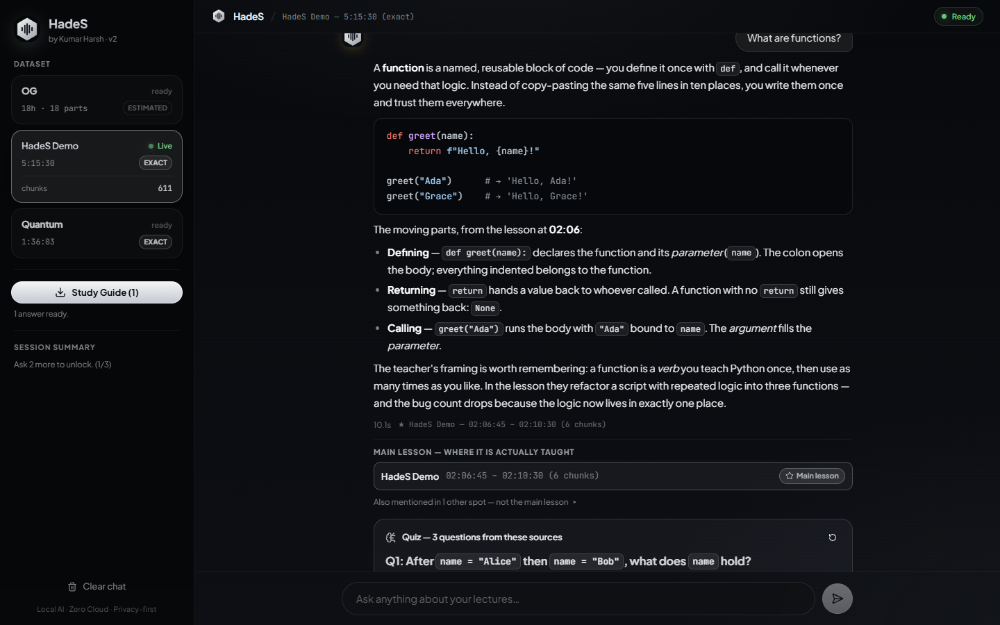
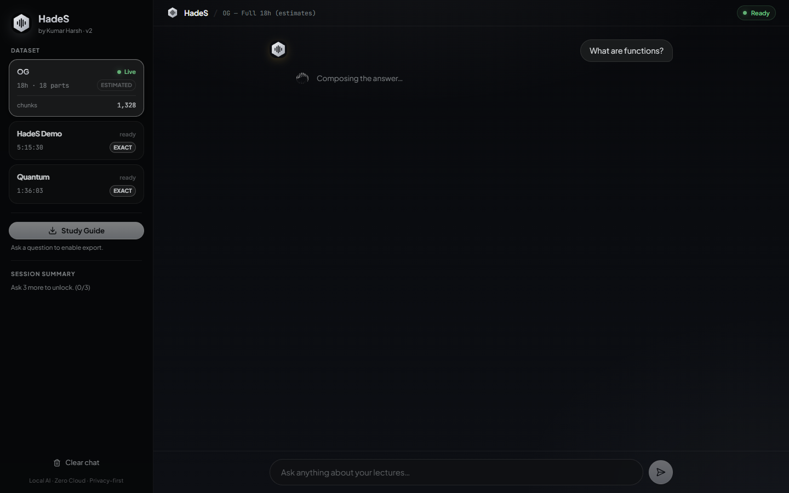
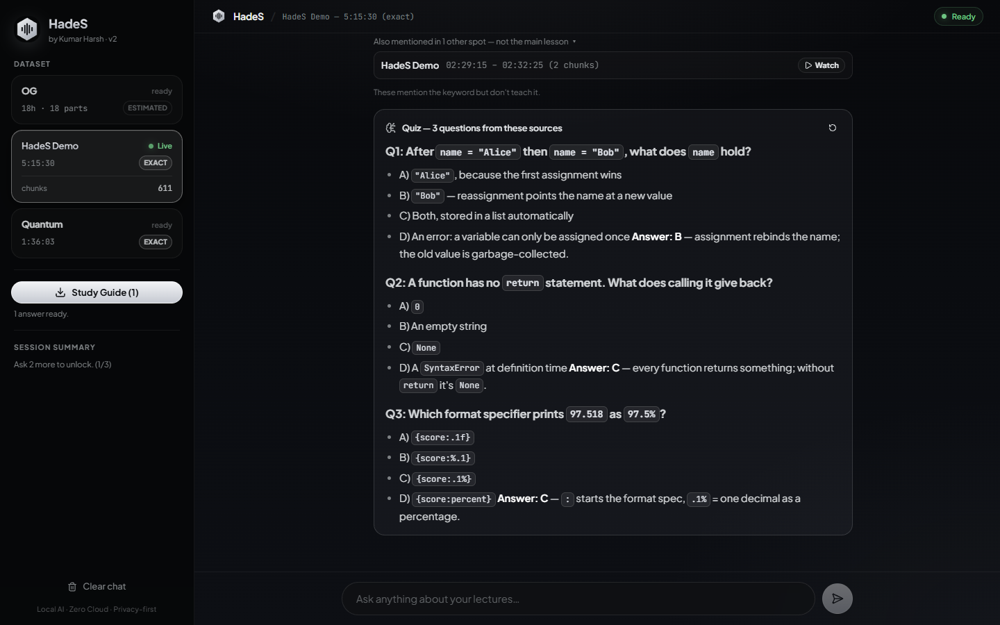
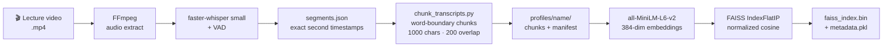
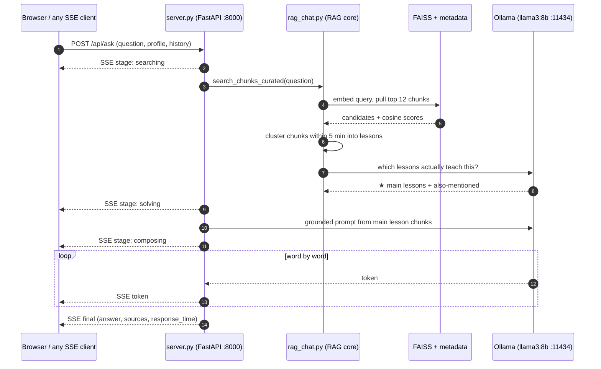
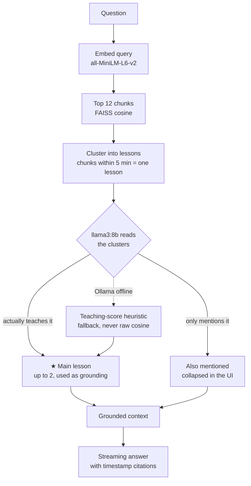

<h1 align="center">HadeS — Teaching Assistant</h1>

<p align="center">
  <b>Turn lecture videos into an interactive AI tutor — fully offline.</b><br/>
  <sub>Ask anything about 18 hours of lectures. Every answer cites the exact minute where it's taught.</sub><br/>
  <sub><i>No API keys · no cloud · nothing ever leaves your machine.</i></sub>
</p>

<p align="center">
  
</p>

> **The interface is private, on purpose.** It is the part of this project I am proudest
> of, and the easiest thing to copy, so the React UI lives in a private repo and is shared
> on request. Everything that makes HadeS work is here — transcription, embeddings,
> curated retrieval, the FastAPI/SSE bridge, the eval harness — and all of it runs
> without the UI.

<p align="center">
  
  
  
  
  
  
  
  
</p>

<p align="center">
  <a href="#-quick-start"><b>Quick start</b></a> &nbsp;·&nbsp;
  <a href="#-screenshots">Screenshots</a> &nbsp;·&nbsp;
  <a href="#-how-it-works">How it works</a> &nbsp;·&nbsp;
  <a href="#-datasets">Datasets</a> &nbsp;·&nbsp;
  <a href="#-api">API</a> &nbsp;·&nbsp;
  <a href="docs/PRD.md">PRD</a> &nbsp;·&nbsp;
  <a href="#-troubleshooting">Troubleshooting</a>
</p>

---

## Why HadeS

- **🎯 Grounded, timestamped answers.** Every reply cites the lesson it came from — `HadeS Demo — 02:06:45 – 02:10:30 (6 chunks)` — and clicking a source plays the lecture **in the answer card**, seeked to the exact second (external YouTube link kept as fallback).
- **🆚 Curated A+B retrieval.** Pull 12 candidates → merge chunks within 5 minutes into lessons → let the LLM pick the **★ main lesson** and demote incidental mentions to *"Also mentioned"*. Retrieval quality is validated in [EVAL.md](EVAL.md): **11/11** eval questions land on the exact teaching chapter.
- **🔒 Fully offline after first download.** No HuggingFace calls at query time, no telemetry, no API bills. Embeddings, ASR, retrieval and generation all run on your machine.
- **🌊 Live pipeline stages.** The UI narrates its own work — `Searching transcripts → Finding the exact lessons → Composing the answer` — then streams the answer word-by-word.
- **📖 What is HadeS? page.** A built-in explainer that shows the product instead of describing it — living cards for timestamped answers, in-place playback, quizzes and privacy. Opens from the landing hero or the sidebar.
- **⏹️ Stop whenever, resume anytime.** Kill any answer mid-stream (stop button or `Esc`), then ask the next question right away. Chat history is stored per dataset in the browser, so a refresh doesn't wipe the session.
- **📝 Quiz me — interactive + Study guide.** Three concept MCQs per answer (from the same grounded context): click an option, get instant grading and the one-line *why*. Missed questions collect in the sidebar **Review** list. Plus per-dataset chat history, session summary, and a one-click markdown study-guide export.
- **🧩 Multiple datasets, zero restarts.** Switch between lecture sets (18 h estimated-timestamp set, a 5 h exact set, a quantum course) from the sidebar — history is kept per dataset.

---

## 🚀 Quick start (from source)

One command starts Ollama and the API; if you have the private `frontend/` checked out
beside it, it starts Vite too and opens your browser on the live URL:

```bash
python dev.py
```

| What happens | Detail |
|--------------|--------|
| 🧠 Ollama preflight | Ready check at `:11434`; auto-starts `ollama serve` if down, warns if the model needs `ollama pull` |
| ⚙️ Backend | FastAPI on `http://localhost:8000/api` — imports `rag_chat.py` untouched |
| ⚙️ API | `http://localhost:8000/api` — `health`, `ask` (SSE), `quiz`, `summary` |
| 🖥️ Frontend | Only when `frontend/` exists: `npm run dev`, Vite picks a free port if `:5173` is taken |
| 🌐 Browser | Opens on the live Vite URL when the UI is there; API-only otherwise |
| 🧹 `Ctrl+C` | Stops the backend + frontend process trees cleanly |

### Basic front end — included and working

`start_hades_ui.bat` (or `python -m streamlit run streamlit_app.py`) opens a plain
Streamlit page on `:8602`: pick a lecture set, ask a question, read the answer, and see the
lessons it came from with their timestamps. No Node.js, no build step, and the RAG core is
untouched — the page calls `rag_chat.search_chunks_curated` and `rag_chat.ask_llm` exactly
the way `server.py` does, so the desk and the API answer alike.

The full React UI (globe landing, in-page lecture player, quizzes, setup guide) stays
private and is shared on request.

Starting from a dirty machine (leftover servers on `:8000` / `:5173-5179`)? Use a fresh boot:

```bash
python dev.py --fresh
```

<details>
<summary><b>One-time setup</b> (clone → install → model)</summary>

```bash
git clone https://github.com/kumarharshzzz04/HadeS.git
cd HadeS

pip install -r requirements.txt     # Anaconda base env is what this is tested on

ollama pull llama3:8b                # the model used for curation + answers
```

No Node.js required: the bundled Streamlit desk is the UI; the React one is private.

The first run downloads the offline models — `all-MiniLM-L6-v2` (~90 MB) and `faster-whisper small` (~460 MB) — **after which HadeS never needs the network again.**
</details>

<details>
<summary><b>Manual two-window flow</b> (kept for reference)</summary>

- **Window 1 — Anaconda Prompt:** `cd /d "<project>" && python server.py` → API on `:8000`
- **Window 2 — the UI:** only if you have the private frontend checked out — `npm run dev` in it
</details>

<details>
<summary><b>Demo mode without Ollama</b> (scripted answers)</summary>

The private UI ships its own mock mode (`VITE_USE_MOCK=1`) that runs on a scripted demo API with the same SSE contract, so screenshots and UI work need no model. Any client can replay those same events against `:8000`.
</details>

---

## 📸 Screenshots

<sub>All captures are the private React UI — they show the product this repo's API powers.</sub>

<p align="center">
  
  <br/>
  <em>Ask a question → grounded answer with citations → ★ Main lesson source card → quiz from the same context.</em>
</p>

<p align="center">
  
  <br/>
  <em>Live pipeline stage while retrieval and generation run locally.</em>
</p>

<p align="center">
  
  <br/>
  <em>3 MCQs per answer, and the A+B split — "Also mentioned" sources are collapsed and labelled as not the main lesson.</em>
</p>

---

## 🏗️ How it works

**v2 is a FastAPI bridge over the original RAG core, with a React UI on top.** No retrieval logic was changed — `rag_chat.py` is imported exactly as it was written. The UI (private, not in this repo) speaks only HTTP/SSE to `server.py`, and anything else speaking the same contract works just as well.

### 1 · Build the index (once per lecture set)



### 2 · Ask a question



### 3 · A+B curation — the part that makes answers trustworthy



---

## 📦 Datasets

| Profile | Source | Chunks | Timestamps | Notes |
|---------|--------|--------|------------|-------|
| `hades_demo` | Datalumina *Python for AI* — 5:15:30 | **611** | **exact** — 3,420 Whisper segments | YouTube deep links seek to the second |
| `quantum` | Quantum computing course — 1:36:03 | **138** | **exact** | ships as a second exact demo |
| `og` | 18 h cut into 18 parts (top-level index) | **1,328** | estimated | the original set |

Switch datasets in the sidebar — no restart, per-dataset chat history.

> **Proven retrieval** ([EVAL.md](EVAL.md)): 11/11 eval questions hit the exact chapter. Example: `what are functions` → `02:06:45 – 02:10:30 (6 chunks)`, with the incidental CSV mention at `02:28` correctly demoted to *Also mentioned*.

---

## 🔌 API

`server.py` exposes the RAG core over HTTP — the frontend has no direct access to `rag_chat.py`.

| Endpoint | Method | Purpose |
|----------|--------|---------|
| `/api/health` | `GET` | `{ ok, ollama, model }` |
| `/api/profiles` | `GET` | Per-profile `ready` + live chunk counts |
| `/api/profiles/{name}` | `POST` | Switch the active profile |
| `/api/ask` | `POST` (SSE) | `stage* → token* → final` — the full grounded answer stream |
| `/api/quiz` | `POST` | 3 concept MCQs from the answer's grounded sources |
| `/api/summary` | `POST` | Session summary once 3+ questions are asked |

---

## 💻 Tech stack

| Layer | Tech |
|-------|------|
| Desk — **included** | Python · Streamlit — `streamlit_app.py`, the basic front end this repo ships |
| Frontend — **private** | React 19 · Vite 8 · Tailwind v4 · Base UI primitives · framer-motion + GSAP · three.js globe (`@react-three/fiber`) · react-markdown + rehype-highlight — kept in a private repo, shared on request |
| API bridge | FastAPI · uvicorn — SSE events `stage` → `token` → `final`; zero changes to retrieval |
| RAG core | `rag_chat.py` — A+B curated retrieval (`RETRIEVE_K=12` → 5-min clusters → `CURATED_MAIN_K=2` ★) |
| LLM | Ollama `llama3:8b` — temperature 0.25, 900 max tokens, 3 turns of chat history |
| Vector search | FAISS `IndexFlatIP` on normalized embeddings (cosine) |
| Embeddings | `all-MiniLM-L6-v2` — 384-dim, cached snapshot, offline |
| Transcription | `faster-whisper 1.2.1` `small` + VAD — exact segment timestamps |

---

## 📁 Project structure

```
HadeS/
├── dev.py                           # one-command launcher (Ollama + backend, + frontend if present)
├── streamlit_app.py                 # basic front end - the desk, calls rag_chat
├── start_hades_ui.bat               # launches it on :8602
├── server.py                        # FastAPI bridge — rag_chat over HTTP/SSE
├── rag_chat.py                      # RAG core — untouched in v2
├── config.py                        # profiles, paths, all tuning knobs
├── process_video.py  chunk_transcripts.py  create_embeddings.py  transcribe_parts.py
│   # no frontend/ here — the React UI is private and dropped in locally when needed
├── app plan/                        # the v2 plan, the Batch 5 ingest plan, decisions
├── profiles/hades_demo/             # 611 chunks · exact timestamps · FAISS + metadata
├── profiles/quantum/                # 138 chunks · exact timestamps
├── faiss_index.bin / metadata.pkl   # og — 1,328 chunks
├── docs/
│   ├── PRD.md                       # product requirements — problem, scope, decisions
│   ├── images/                      # README screenshots
│   └── superpowers/specs/           # design docs
├── onepager/                        # standalone product poster (HTML + PNG + PDF)
├── EVAL.md                          # 11/11 retrieval proof
└── requirements.txt
```

---

## 🛠️ Troubleshooting

| Symptom | Fix |
|---------|-----|
| "Couldn't reach the HadeS server" | Backend isn't up — run `python dev.py` (or `python server.py` in the Anaconda Prompt) |
| `ModuleNotFoundError: fastapi` | Use the **Anaconda Prompt** (base env) and `pip install -r requirements.txt` |
| "Ollama failed" in answers | `ollama run llama3:8b` once to pull/load the model |
| Port 5173 busy / stale servers | `python dev.py --fresh` — it kills leftovers on `:8000` and `:5173-5179` first |
| UI looks unstyled | Hard refresh (`Ctrl+Shift+R`) — the theme loads with the page |
| No UI to open | Use the bundled desk: `start_hades_ui.bat` (`:8602`). The React UI is private |
| `ModuleNotFoundError: streamlit` | `pip install -r requirements.txt`, or just run `start_hades_ui.bat` |
| `No index for profile` | `python create_embeddings.py --profile <name>` |
| WiFi off → 2-minute hang | Already fixed via offline snapshots (`HF_HUB_OFFLINE=1` in `server.py` / `rag_chat.py`) |
| `cublas64_12.dll` at transcribe | `pip install nvidia-cublas-cu12 nvidia-cudnn-cu12` (handled via `os.add_dll_directory`) |
| `libiomp5md.dll` double load | `KMP_DUPLICATE_LIB_OK=TRUE` (set inside the scripts, `server.py` and `transcribe_parts.py`) |

---

## 🔜 Roadmap

- [x] Streaming answers, real timestamps, multi-profile datasets
- [x] FastAPI bridge (v2), with the React UI kept in a private repo
- [x] Preload models at startup (kill the first-question lag)
- [x] Stop-generation button + per-dataset chat persistence
- [x] Interactive quiz with instant grading + missed-question review
- [x] In-page video player that seeks to the cited timestamp (`og` 18 h set has no single video → rows stay inert)
- [ ] Hybrid BM25 + dense retrieval with cross-encoder re-ranking
- [ ] Voice input

---

## 🖥️ Front end

**A basic front end is included and works.** `streamlit_app.py` (launched by
`start_hades_ui.bat`) asks a question, streams nothing complicated, prints the answer and
lists the lessons behind it with their timestamps and snippets. It depends on nothing
private.

The React 19 + Vite + Tailwind interface is deliberately **not** in this repository. It is
the part of HadeS I am most protective of — the landing page, the in-place lecture player,
the streaming answer, the quiz, the setup guide — so it stays private and is shared on
request rather than published.

Everything else is here and runs without it: the transcription and embedding pipeline, the
FAISS retrieval core, the curated A+B retrieval, the FastAPI/SSE bridge, the quiz and
summary endpoints, and the eval harness. Point any SSE client at
`http://localhost:8000/api` and you get the same stream the UI consumes.

---

## 📄 License & author

**Public to read, free to use for non-commercial work — commercial use needs a paid
license.** See [LICENSE](LICENSE). Reading the code, running it on your own machine,
using it in a course or a portfolio piece, and changing it for any of that costs nothing
and needs no permission. Using it inside a company's product or internal tooling,
hosting it for other people, or shipping it in paid work needs a written commercial
license first: **kumar.harshzzz04@gmail.com**. The bundled Streamlit desk is covered by
the same terms as the rest of the repository.

Built by **Kumar Harsh** · [@kumarharshzzz04](https://github.com/kumarharshzzz04)

<sub>HadeS — Local AI · Zero Cloud · Maximum Privacy</sub>
