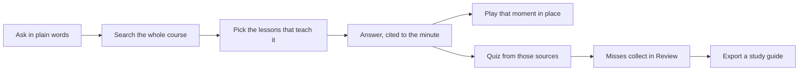
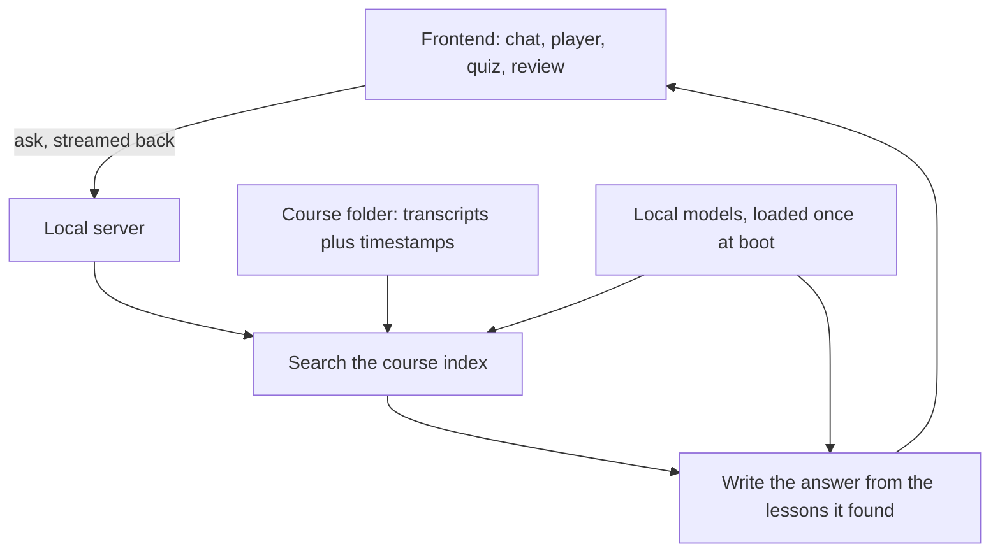

# HadeS — Product Requirements Document

**Owner:** Kumar Harsh
**Version:** 1.0 — 9 October 2026
**Product state:** v2 in daily use, local only
**Where this lives:** `docs/PRD.md`, with README, NOTES and EVAL at the repo root

---

## 1. What HadeS is

HadeS turns my recorded lectures into something I can talk to.

I give it a course folder. It listens to the lectures once, keeps the whole course in memory, and after
that I can ask questions in plain English. Every answer comes out of what the teacher actually said in
that course, and every answer carries the lesson and the minute it came from. Click the source and the
lecture plays inside the answer, already seeked to the second.

It runs on my laptop. Nothing is uploaded, there is no account, and it keeps working with the internet
switched off.

One line, if someone asks what my project is: **ask your lectures, get the answer and the exact minute.**

---

## 2. Why I'm building it

Three courses of recorded classes is around 25 hours of video. That's not a learning problem, that's a
finding-things problem. When I need one explanation — say, why reassigning a variable works the way it
does — I know it's in there somewhere. What I don't know is whether it's at 01:01 or 02:06 of part 12,
and re-watching to locate one moment costs more than the moment is worth.

Timestamps exist, but they're just an index of time. You can't search them for meaning.

**What I tried instead, and why it wasn't enough:**

- Searching the YouTube transcript: keyword matching. If I don't type the exact word the teacher used, I
  get nothing. And it never answers a question, it just finds words.
- A hosted chatbot: I'd have to upload 25 hours of someone else's lectures, it answers from the whole
  internet instead of my course, it invents things confidently, and it gives me no timestamp to check.
- Notes: they're only as good as the day I wrote them.

I want the answer, the source, and the proof — from my course, on my machine. That's the whole product.

**Why this is possible now:** these models fit on a laptop GPU. I'm running on an RTX 4050 with 6 GB of
VRAM. Two years ago this was a cloud product, so it had to be someone else's server and someone else's
terms. Now it can just be mine.

---

## 3. Who it's for

**Primary user: me.** I have three recorded courses and a habit of asking "wait, where was that explained?"

**Secondary:** classmates sitting on the same recordings, and any teacher who wants a study aid built from
their own lectures without handing the material to a company.

**Where it stops:** this is not note-taking during class, not a live lecture tool, not multi-user, not a
shared cloud library. It's one person, one (or a few) courses, one laptop.

---

## 4. The experience today (v2)

This is what a session actually looks like, because this is the part I care about:

1. I pick a course in the sidebar. History, review list and everything else is per course, so switching
   never mixes two subjects together.
2. I ask a question the way I'd ask a friend. No keywords, no lecture numbers.
3. The UI narrates what it's doing — searching the transcripts, finding the exact lessons, composing —
   then the answer streams in word by word.
4. The answer is written like a short lesson: the definition, the moving parts, a concrete example from
   the lecture. Under it sits the citation: the main lesson it came from, plus the passing mentions.
5. I click the source. The lecture opens inside the answer card, seeked to that second. If I want, I
   follow the link outward instead.
6. When the moment is fresh, I hit **Quiz me**. Three questions come from the same sources, I pick
   answers, and each one gets graded instantly with the one-line *why*.
7. Questions I get wrong land in the sidebar **Review** list. When I'm done, the session exports as a
   study guide I can revise from.
8. After a few questions I can generate a session summary — what I actually covered.

There are also two explanation artifacts I keep in the repo: the **"What is HadeS?" page** inside the
app, and a **standalone one-pager poster** (HTML, PNG, PDF) for showing someone in ten seconds.

If it isn't in the course, it should say so rather than guess. I'd rather get nothing back than get
something confident and wrong.

---

## 5. Requirements

### P0 — without these it isn't the product

| ID | Requirement | Acceptance |
|----|-------------|------------|
| R1 | Answers come only from the active course | Every answer's sources belong to the selected dataset; no cross-course bleed |
| R2 | Every answer cites lesson + minute | Each reply shows a main lesson (name + time range) and the other mentions apart from it |
| R3 | Refuse instead of inventing | Off-topic question returns the honest "couldn't find this" message, no sources, no invented facts |
| R4 | Play the cited moment in place | Clicking a source plays the lecture inside the answer card, seeked to the cited second |
| R5 | Quiz from the answer's own sources | 3 MCQs generated from the same retrieved context, each graded with the *why* |
| R6 | Misses survive as review | Wrong answers collect per course in the sidebar and export with the study guide |
| R7 | Per-course isolation | History, review list, summary and export are separate for each course |
| R8 | Fully offline after first download | Works with the network off; no telemetry, no keys, no accounts |
| R9 | Runs on a normal laptop | GPU when available, CPU fallback when not, no cloud dependency |

### P1 — should be there, next release

| ID | Requirement | Notes |
|----|-------------|-------|
| R10 | Follow-ups use the conversation | Retrieval currently ignores history, so "what about functions?" searches the wrong thing. Rewrite the question into a standalone one before retrieving |
| R11 | Regenerate an answer | Same as quiz regenerate: keep the old take, add a new one |
| R12 | Dataset switching without restarts | Already works; keep it that way |
| R13 | Session summary | Unlocks after 3 questions in a course |
| R14 | Copy an answer | One click, whole answer |
| R15 | Respect reduced motion | No looping animation when the OS asks for less |
| R16 | Usable on a phone browser | It's a laptop tool, but reading a study guide on a phone should not be broken |

### P2 — later, if I still want them

Clip notes (save a moment with a note of my own), spaced repetition from the review list, a lesson map
that clusters a whole course into an outline I can jump around in, keyboard shortcuts, dictation for
asking by voice, multi-language courses.

### Not in scope

Accounts, cloud sync, hosted models, mobile apps, multi-user courses, live lecture capture. Anything that
puts someone else's server between me and my own course.

---

## 6. Non-functional requirements

**Latency.** Retrieval plus reranking is about 1.3 s, which is why the stage narration matters — it's the
difference between "working" and "hanging". A full grounded answer lands around 25 s warm on my machine;
the first words stream well before that. Cold start is a different animal and I've been bitten by it: the
first request after a fresh process paid 45 s because the models weren't warm. Budget: retrieval under
2 s, first token under 3 s once warm, full answer under 30 s.

**Grounding quality, measured.** I keep an eval set of 11 questions against the full 18-hour course. All
11 land on the exact teaching chapter. That number is the one I trust, and it's the one I re-run whenever
retrieval changes.

**Refusal calibration.** Grounded recall on real questions bottoms out around 0.37; off-topic questions
top out at 0.25. The floor sits at 0.35 between those two, and I re-measure it whenever the retrieval
changes rather than trusting the old number.

**Privacy.** Everything local: transcription, indexing, retrieval, generation. No uploads, no telemetry,
no API keys, no accounts.

**Hardware.** Target is a laptop with a mid-range GPU (6 GB VRAM). CPU fallback has to work, just slower.
Courses are large single files (one is 18 hours), so transcription runs in parts and everything after it
is incremental.

**Storage of state.** Browser storage holds chat history per course, so a refresh doesn't wipe the
session. It also means a cleared browser clears the history — acceptable, since the courses themselves
stay indexed on disk.

---

## 7. How I know it's working

- **Grounding holds:** the eval stays 11/11 as I add courses, and no answer ever appears without a source.
- **Refusal is honest:** off-topic questions get refused, wrong-topic questions don't.
- **Time saved:** I go from "I know it's in there somewhere" to the exact minute in one question instead
  of scrubbing a timeline.
- **Study loop closes:** quiz misses turn into a review list, and the review list turns into revising
  that actually targets what I got wrong.
- **Answer quality:** I can read the answer and not need the video — the citation is there for when I
  want the teacher's exact wording.
- **Public artifacts stay honest:** the in-app page and the one-pager explain the product without naming
  a single library, model or file. The internals live in README, NOTES, EVAL and this document.

---

## 8. Things I tried that didn't work

I keep this section because a PRD that only lists what shipped is useless six months later. Every one of
these cost real time, and each one has a number behind it.

**Answer-length modes — built, measured, deleted.** I shipped a "fast" mode next to the normal answer:
heuristic lesson picking instead of the curation pass, a short-answer prompt, and a cap on the output.
It was genuinely faster. 6.6 s and a 186-character reply, against 24.5 s and 1,160 characters for the full
pipeline on the same question. But a one-line answer to "how does pip install work?" is not worth
reading, and the short answers were sometimes beside the point. The mode is gone. Thorough is the
product, and if I want speed later it has to come from somewhere that doesn't cost content.

**Hybrid keyword + dense retrieval — parked.** The idea was to combine keyword matching with the dense
search so exact terms, like function names, stop getting lost. First attempt landed 7 of 11 eval
questions on the right chapter, against 9 of 11 for dense-only on the same questions. Keyword search kept
pulling in chunks that matched words without teaching the topic. It comes back only as a proper fused
pool with the reranker on top, not as a union of two result lists.

**A confidence score on screen — decided against.** The grounding check produces a score and I could show
it. I don't. On this model a middling number next to a perfectly good answer reads as "the machine isn't
sure", and then the user starts doubting correct output. The citation is the proof I trust and the proof
they can check. The score stays internal, in NOTES, not on the page.

**Cold-start trap — fixed, worth remembering.** Starting the server by importing the app instead of
running it normally skipped the model warm-up, so the first question paid 45 s while everything loaded.
Nothing was broken; it just looked broken. The rule now is that whatever starts the server warms the
models, and the stage narration covers whatever is left.

---

## 9. Milestones

**Shipped (v1 → v2):** transcription with real timestamps, dense retrieval with reranking and lesson
clustering, curated main-lesson plus mentions, streaming answers with sources, in-page player seeked to
the cited second, refusal, grounding validation, quiz, review list, study guide export, session summary,
per-course isolation, dataset switching, mock mode for demos without a backend, "What is HadeS?" page,
one-pager poster.

**Next (v2.1):** follow-ups that understand the conversation (R10), regenerate answer (R11), a length and
quality guardrail on answers, keyboard shortcuts. Small, all in code I already own.

**Then (v3):** lesson map per course, spaced repetition built on the existing review list, clip notes,
dictation, multi-language. Bigger swings, each one its own project.

**Parked, with reasons:** a hybrid keyword + dense retrieval pass looked promising but measured 7/11
against the dense pipeline's 9/11 on the same questions in an earlier form. It comes back only as a
proper fused pool with a reranker on top. Cloud anything is out. Answer-length modes came and went — see
the decisions below.

---

## 10. Risks and open questions

- **Retrieval on new courses.** The eval set is 11 questions and it's my questions. A different subject
  could behave differently. I need a cheap way to spot-check a new course without writing a new eval.
- **Follow-ups.** Known bug, known fix (R10). Until it's fixed, a pronoun-led question can retrieve the
  wrong lesson, which looks worse than refusing.
- **Latency on CPU-only machines.** Fine for me, possibly painful elsewhere. I haven't measured a full
  answer on CPU.
- **Hallucination.** Grounding validation exists and is measured, but there's no UI surface for it. I
  deliberately don't show a confidence score — a low number next to a good answer makes the whole thing
  look weak, and the citation is the proof I actually trust.
- **Transcription on hard audio.** Heavy accents, noisy rooms, crosstalk. One course already has
  estimated timestamps because of it.
- **Very long files.** 18 hours in one dataset, split into parts. Part boundaries are where a lesson can
  get cut in half, and the clustering has to survive that.
- **Single-user assumption.** One machine, one browser, no sync. If I clear storage I lose history.
- **Study-guide export looked broken once, and wasn't.** I checked it: the export is a client-side file
  download, not a server call, so it never appears in the network tab — which is why an early session
  logged it as "the button did nothing". The button is live from the first answered question and says how
  many answers are ready. The remaining risk is the opposite one: a guide exported after one answer is
  thin, and nothing warns about that.

---

## 11. Decisions I've made, and why

- **Local only.** Privacy, no bills, and honestly it's the interesting version of the project. The
  offline promise is also the thing people react to first.
- **Cite first, then talk.** The citation is the product. A beautiful answer I can't verify is worse than
  a plain one I can.
- **Answer style: teach, don't summarize.** Short lesson with the definition, the parts, and a real
  example from the lecture. When I tried a "fast" mode that answered in one line, the answers were too
  thin to use, so I deleted the mode instead of shipping it.
- **No confidence badge in the UI.** Grounding scores stay internal; the source list is what the user sees.
- **Public pages never name the stack.** The "What is HadeS?" page and the poster talk about what the
  product does, never which libraries it uses. The README, NOTES, EVAL and this PRD carry the internals.
- **One app, one process, one user.** A React frontend and a small FastAPI server that wraps the retrieval
  and generation code. No microservices, no queue, no database server. It's a laptop tool.
- **One-pager as an artifact, not a feature.** The poster (HTML + PNG + PDF) is a separate file in the
  repo. It's for showing someone, not for shipping inside the product.

---

## 12. Where things live

- **The app:** React + Vite frontend, FastAPI server, the retrieval and generation code behind it.
- **Courses:** one folder per dataset, with transcripts and segment timestamps; adding a course is a
  folder plus a config entry.
- **Docs:** README (what it is and how to run it), NOTES (state, measurements, what failed) and EVAL
  (retrieval eval set and results) at the repo root; this document in `docs/`.
- **Artifacts:** the in-app explainer page, and the standalone one-pager poster with its PNG and PDF.

**Shape of the system**, in one diagram:

**On images:** this document stays text-first. The two diagrams above render on GitHub, tables carry the
numbers, and screenshots don't belong here because they go stale faster than the words do. Product
visuals live in their own places: the poster and any future screenshots in `onepager/` at the repo
root, the explainer
page inside the frontend. If a picture ever is the only way to explain something, it goes in `onepager/`
and gets linked from here.

---

*Next revision of this doc: when v2.1 lands.*
